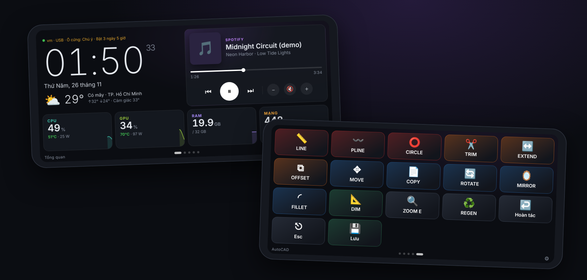
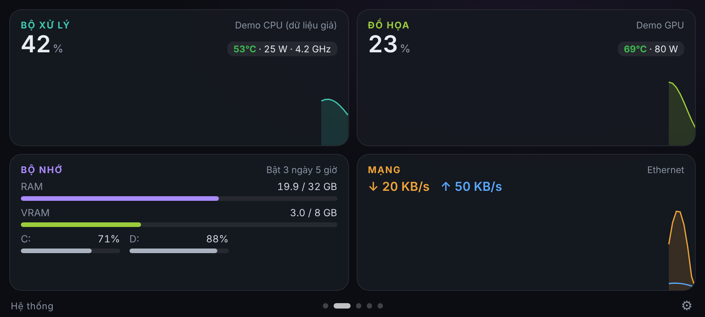
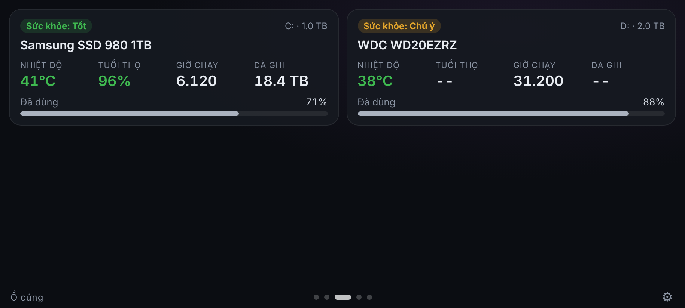
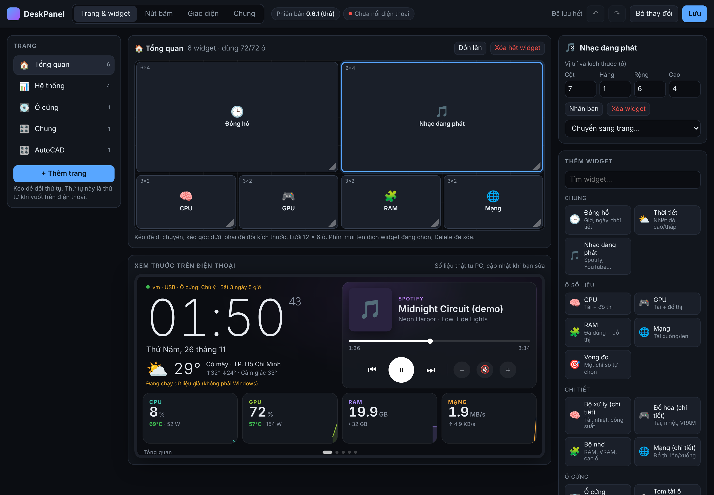
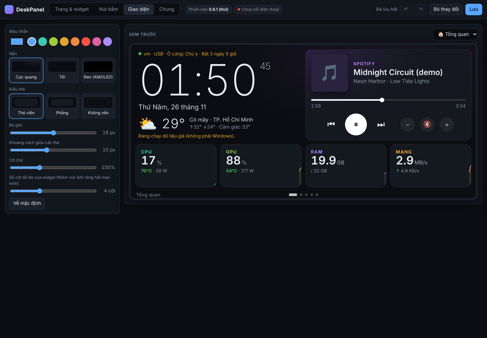

<p align="center"></p>

<h1 align="center">DeskPanel</h1>

<p align="center"><b>Biến chiếc điện thoại Android cũ thành màn hình phụ cho PC Windows.</b><br>
Thông số máy, sức khỏe ổ cứng, thời tiết, nhạc đang phát và bảng nút lệnh AutoCAD, phím tắt, nối qua cáp USB.<br>
Không cần root, không cần tài khoản, không qua dịch vụ đám mây nào.</p>

<p align="center">
  <a href="../../releases/latest"><b>Tải về</b></a> ·
  <a href="#cài-nhanh"><b>Cài nhanh</b></a> ·
  <a href="pkg/HUONG-DAN.md"><b>Hướng dẫn đầy đủ</b></a> ·
  <a href="CHANGELOG.md"><b>Nhật ký thay đổi</b></a>
</p>

<p align="center">
  
  
  
  
</p>

<p align="center"><br>
<sub>Ảnh chụp với dữ liệu mẫu.</sub></p>

DeskPanel gồm một **chương trình nhỏ chạy ngầm trên PC** và một **trang web toàn màn hình trên điện thoại**. Điện thoại nối với PC qua cáp USB (`adb reverse`), nên không mở cổng nào ra mạng LAN. Bạn tự xếp các trang và widget bằng trình chỉnh sửa kéo thả ngay trên PC, có xem trước trực tiếp.

## Làm được gì

| Dùng để | Trên điện thoại hiện |
|---|---|
| **Theo dõi máy** | CPU, GPU, RAM, VRAM, nhiệt độ, công suất, xung nhịp, mạng lên/xuống, đồ thị 90 giây, vòng đo tự chọn |
| **Ổ cứng** | Sức khỏe SMART từng ổ (Tốt / Chú ý / Hỏng), nhiệt độ, tuổi thọ SSD, số giờ chạy, dung lượng đã ghi |
| **Làm việc với AutoCAD** | Nút lệnh `L`, `TR`, `O`, `Z E`… bấm một chạm: tự đưa AutoCAD lên trước, Esc, gõ lệnh, Enter |
| **Phím tắt, chương trình** | Tổ hợp phím (`Ctrl+S`, `Win+Shift+S`), mở chương trình, thư mục, trang web, gõ sẵn đoạn chữ |
| **Hằng ngày** | Đồng hồ lớn, thời tiết (Open-Meteo, dự phòng MET Norway và wttr.in), nhạc đang phát kèm ảnh bìa và nút điều khiển |

## Ảnh chụp

<table>
  <tr>
    <td><br><sub>Hệ thống: CPU, GPU, bộ nhớ, mạng</sub></td>
    <td><br><sub>Ổ cứng: sức khỏe SMART từng ổ</sub></td>
  </tr>
  <tr>
    <td><br><sub>Cài đặt: kéo thả widget trên lưới 12 × 6, xem trước trực tiếp</sub></td>
    <td><br><sub>Giao diện: màu nhấn, nền, kiểu thẻ, bo góc, cỡ chữ</sub></td>
  </tr>
</table>

## Cài nhanh

Bạn cần PC **Windows 10/11 64-bit**, điện thoại **Android có Chrome** và một sợi **cáp USB truyền dữ liệu**. Bản phát hành đã kèm sẵn .NET nên không phải cài thêm.

### 1. Trên PC

1. Tải `DeskPanel-x.y.z-win-x64.zip` ở mục [Releases](../../releases/latest), giải nén vào `C:\DeskPanel`.
2. Tải [Android Platform Tools](https://developer.android.com/tools/releases/platform-tools), chép thư mục `platform-tools` vào `C:\DeskPanel\`.
3. Muốn đọc nhiệt độ CPU thì cài PawnIO: `winget install namazso.PawnIO`, rồi khởi động lại máy.
4. Nhấp đúp `install.cmd`, bấm **Yes**. DeskPanel tự chạy mỗi khi đăng nhập Windows.

> **SmartScreen:** file chưa có chữ ký số nên Windows có thể cảnh báo. Bấm **More info → Run anyway**.
> DeskPanel chạy với quyền admin để đọc cảm biến và SMART; các chương trình nó mở vẫn chạy với quyền thường.

### 2. Trên điện thoại

| Bước | Làm gì |
|---|---|
| Bật gỡ lỗi USB | Cài đặt → Thông tin điện thoại → chạm 7 lần **Số hiệu bản tạo** → Tùy chọn nhà phát triển → bật **Gỡ lỗi USB** và **Luôn bật màn hình khi sạc** |
| Cắm cáp | Khi điện thoại hỏi, tích **Luôn cho phép từ máy tính này** → **Cho phép** |
| Mở bảng | Chrome → `http://localhost:8765` → ⋮ → **Thêm vào màn hình chính** |

### 3. Tùy biến

Mở `http://localhost:8765/settings.html` trên PC (hoặc chạm ⚙ trên điện thoại):

- **Trang & widget**: thêm trang từ mẫu, kéo thả và đổi cỡ 16 loại widget, xem trước với số liệu thật.
- **Nút bấm**: thư viện nút theo nhóm, 5 loại lệnh, thử nút ngay trên PC.
- **Giao diện**: màu nhấn, nền cực quang / tối / đen AMOLED, kiểu thẻ, bo góc, khoảng cách, cỡ chữ.
- **Chung**: thời tiết, cổng, adb, và **cập nhật** (tải zip lên hoặc tự lấy bản mới từ GitHub).

Bấm **Lưu**, điện thoại tự tải lại.

## Cập nhật

Từ bản 0.6, vào **⚙ → Chung → Cập nhật DeskPanel**: điền repo `kthtuan/DeskPanel` để DeskPanel tự báo bản mới (6 giờ kiểm tra một lần), rồi bấm **Cài bản …**. Repo để private thì dán thêm một token GitHub chỉ đọc, xem [hướng dẫn](pkg/HUONG-DAN.md#e-cập-nhật-lên-bản-mới). Các nút, trang và giao diện của bạn luôn được giữ nguyên.

## An toàn

- Chỉ nghe tại `localhost`. Điện thoại vào được nhờ `adb reverse` qua cáp; máy khác trong mạng không vào được.
- Mọi lệnh nằm trong `config.json` trên PC. Điện thoại chỉ gửi mã nút, không gửi được lệnh tùy ý.
- Trang web lạ mở trên PC không gọi được DeskPanel: yêu cầu thay đổi phải kèm header riêng và đúng tên máy `localhost`.
- Token GitHub (nếu có) được mã hóa theo tài khoản Windows (DPAPI), không nằm trong `config.json`.

## Cấu trúc mã nguồn

```
src/                 Chương trình PC (C# .NET 8, ASP.NET Core minimal API)
  Stats.cs           Đọc cảm biến (LibreHardwareMonitorLib) và SMART (DiskInfoToolkit)
  Actions.cs         Gửi phím, gõ chữ, mở chương trình, lệnh AutoCAD
  Extras.cs          Nhạc đang phát (Windows Media Session), thời tiết
  Updater.cs         Cập nhật từ zip / GitHub Releases
  wwwroot/           index.html (điện thoại), settings.html (cài đặt)
pkg/                 install / update / uninstall và hướng dẫn tiếng Việt
.github/workflows/   Tăng <Version> và đẩy lên main là GitHub tự build và phát hành
```

Build thủ công:

```
dotnet publish src/DeskPanel.csproj -c Release -r win-x64 -o out/DeskPanel
```

## Nguồn

Bố cục giao diện lấy cảm hứng từ [PhoneBox](https://github.com/ersinkoc/phonebox) (MIT, © 2026 Ersin KOÇ). DeskPanel không chép mã của PhoneBox; toàn bộ được viết lại.
Cảm biến: [LibreHardwareMonitor](https://github.com/LibreHardwareMonitor/LibreHardwareMonitor) (MPL-2.0). Thời tiết: [Open-Meteo](https://open-meteo.com), [MET Norway](https://api.met.no), [wttr.in](https://wttr.in).
